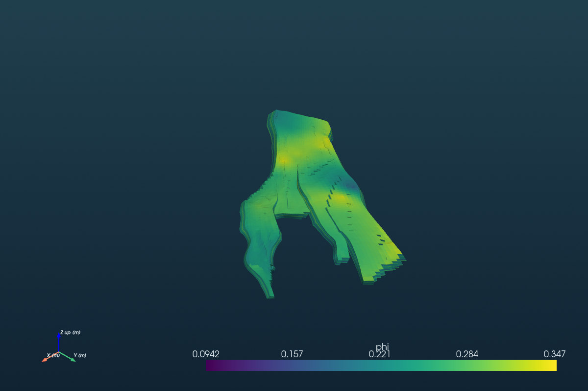

# Kanysh Basic

[Сайт: kanysh.com](https://kanysh.com) · [English](README.md)

**AI-копилот для расчётов по геологическим моделям рядом с Petrel и RMS.**
Откройте выгруженную модель, запросите проверку или сценарий в чате и получите
отчёт с допущениями и независимыми численными проверками.

Kanysh Basic — MCP-сервер и локальный веб-просмотрщик. MCP — подключение, через
которое чат получает доступ к расчётным инструментам. Чат запрашивает работу;
просмотрщик показывает проекты, ревизии, отчёты и 3D-сцены. Численные расчёты
выполняются локально. Какие сообщения и результаты получает AI-провайдер, определяет ваш чат-клиент.

**Windows: [установка расширения Claude Desktop за три шага](docs/INSTALL_WINDOWS.ru.md).**
Скачайте `.mcpb` из релиза → двойной клик → Install → выберите папку модели.
Для статических расчётов терминал и WSL не нужны. Требуются клиент с UV runtime MCPB 0.4
и интернет при первой загрузке зависимостей. [English instructions](docs/INSTALL_WINDOWS.md).

Приёмка нативной Windows и реальной установки в Claude Desktop остаётся **NOT RUN**.
Пакет и Windows CI подготовлены; это ещё не подтверждение проверенного Windows-релиза.
[Установка из исходников на macOS/Linux и первый результат](docs/GETTING_STARTED.ru.md).



*Публичные данные Statoil / OPM: 44 927 активных ячеек, ODbL-1.0 / DbCL-1.0.
Параметры флюидов в демо — явные тестовые допущения, а не оценка запасов месторождения.*

## Получите первый результат

1. **Установите на Windows** по [инструкции из трёх шагов](docs/INSTALL_WINDOWS.ru.md).
   Оставьте `%LOCALAPPDATA%\kanysh-basic` для результатов и выберите настоящую папку модели.
2. **Нажмите Open Norne demo** в просмотрщике: появятся готовые геометрия и отчёты.
   Это сохранённый пример, новый расчёт не запускается.
3. В Claude напишите: **«Вызови start Kanysh Basic, затем оцени подключённую папку модели».**
   Убедитесь, что появились реальные результаты инструментов. Другую папку можно подключить через **Add folder**.
4. Подтвердите предложения из файлов, запросите QC или сценарий. Сохраните отчёт и
   XLSX/PDF. При повторном подключении используйте ту же папку результатов.

Для **macOS/Linux или установки из исходников ИТ-службой** установите
[uv](https://docs.astral.sh/uv/getting-started/installation/), откройте папку проекта и выполните:

```bash
uv python install 3.12
uv sync --frozen --no-dev --extra ui --extra viewer --python 3.12
uv run --no-sync kanysh-basic --home "$HOME/.kanysh-basic" setup
```

Перед setup закройте клиенты Claude. Команда сохраняет резервную копию настроек
и открывает просмотрщик. По умолчанию используется **CPU-сборка PyTorch**;
[NVIDIA подключается отдельно](docs/INSTALL_WINDOWS.ru.md).
**WSL/Linux нужен только для гидродинамики OPM Flow**, полная приёмка которой — NOT RUN.
Расширение содержит исходный код; Python и зависимости устанавливает клиент.
Реальная приёмка внешних чат-клиентов остаётся **NOT RUN**.

## CPU или NVIDIA

Доступны два расширения: `kanysh-basic-0.2.0-dev3.mcpb` (CPU) и
`kanysh-basic-gpu-0.2.0-dev3.mcpb` (GPU). Их можно установить рядом; оставьте разные
папки результатов: `%LOCALAPPDATA%\kanysh-basic` и `%LOCALAPPDATA%\kanysh-basic-gpu`.
GPU-вариант загружает около **2,5 ГБ** при первой установке, выбирает CUDA 12.6 на
Windows/Linux и CPU на macOS. Без доступной CUDA он работает на CPU с предупреждением.
Расчёты сохраняют прежний CPU по умолчанию: для поддерживаемых операций агент должен
явно выбрать `prefer_gpu` с разрешённым CPU fallback либо `require_gpu`. MPS не реализован.

Зависимости устанавливает Claude **до запуска Python**. Быстрая инициализация MCP не
устраняет таймаут хоста во время загрузки; фактическая установка через Claude Desktop
остаётся NOT RUN. После запуска Python список инструментов доступен сразу; `STARTING`
указывает время повтора, `FAILED` — путь к журналу. Реальный путь результатов, включая
виртуализацию LocalAppData в MSIX, виден в просмотрщике и `startup-status.json`.
[Устройство запуска и результаты проверок](docs/DESKTOP_STARTUP.md).

Сборка из подготовленного окружения исходного проекта (нужны Node/npm и `uv`):

```bash
uv run --no-sync python scripts/build_mcpb.py --variant cpu
uv run --no-sync python scripts/build_mcpb.py --variant gpu
```

Команды используют официальный `mcpb validate` / `mcpb pack` и отдельные UV lock-файлы.
`--refresh-lock` нужен только для намеренного обновления разрешения зависимостей.

## Пять задач для чата

| Задача | Пример фразы |
|---|---|
| Проверить модель | «Изучи зарегистрированную папку, объясни, чего не хватает, затем проверь импортированную модель. Покажи серьёзность проблем и IJK». |
| Посчитать объёмы по регионам | «Подготовь расчёт нефти и свободного газа по регионам. Уточни контакты, Bo/Bg и насыщенности; считай после моего подтверждения». |
| Сверить с Petrel/RMS | «Сверь региональные объёмы с моим CSV из Petrel. Объясни разницу в единицах, определениях и допущениях, не меняя входы». |
| Оценить чувствительность | «Построй торнадо для диапазонов, которые я задам. Сохрани базовый сценарий и допущения». |
| Сравнить версии | «Сравни две ревизии с одинаковой IJK-сеткой. Покажи изменённые ячейки и влияние на поровый объём регионов». |

Агент запрашивает необходимые инженерные данные. Значения из файлов остаются
предложениями с указанием источника до вашего подтверждения. Недостающие константы
не подставляются. Численный PASS всё равно требует геологической экспертизы.

## Подготовьте модель и прочитайте результат

Выгружайте обменные файлы из Petrel/RMS: нативные базы проектов не поддерживаются.
Для первой проверки сетки предпочтителен ECLIPSE ASCII DATA/GRDECL со всеми INCLUDE,
геометрией, маской активных ячеек и свойствами. [Инструкция экспорта](docs/PETREL_EXPORT.md).

Откройте страницу отчёта, проверьте допущения, независимые проверки и таблицы регионов.
Запросите Excel/PDF и сохраните файлы по полученным ссылкам. Завершённое задание
может содержать QC-замечания. `NOT RUN` означает, что проверка не выполнялась.
[Как читать статусы и сохранять отчёт](docs/GETTING_STARTED.ru.md).

Принятые сценарии также включают обменные поверхности/траектории/разбивки/полигоны,
сравнение с LAS, явные функции насыщенности по высоте и коррелированный скалярный
Монте-Карло. [Функционал и проверки](docs/COPILOT_RESULT.md) · [Сценарий Norne и точные числа](docs/DEMO.md).

## Текущие ограничения

- `eclipse_import` потоково читает ASCII DATA/GRDECL и EGRID со свойствами INIT/GRDECL.
  Старый путь XTGeo/ROFF сохраняет лимит **2 млн ячеек**.
  [Реализация масштабирования](docs/SCALING.md) · [Замеры и границы проверки](docs/BENCHMARKS.md).
- Неподдерживаемые DATA-ключевые слова перечисляются в отчёте. SWATINIT не подменяет равновесную SWAT.
- Bo/Bg, контакты, насыщенности, единицы и CRS/datum требуют явного основания.
  STOIIP/GIIP — начальные объёмы, а не извлекаемые запасы или прогноз добычи.
- Полигон отбирает целые ячейки по среднему XY углов; Sw по высоте оценивается по
  среднему Z углов. Скалярная неопределённость не заменяет пространственное моделирование.
- CPU-блоки поддерживают пул процессов с проверкой ресурсов. Региональные объёмы
  и volumetrics на импортированных corner-point сетках также поддерживают CUDA float64
  с обязательной сверкой с CPU. Ограничивается превью;
  расчётные входы не прореживаются. OPM Flow end-to-end — **NOT RUN**.
- Веб-приложение — просмотрщик на английском. Расчёты запускаются через чат/MCP,
  CLI или REST. Gradio/Plotly находятся в `[ui]`, создание сцен — в `[viewer]`.

Перечисленные сценарии входят в Kanysh Basic. Дальнейшее моделирование относится
к **Kanysh Advanced**: [планы развития](docs/ROADMAP.md). Локальные Advanced-эксперименты
исключены из GitHub-публикации Basic, пакетов и production MCP.

## Технический справочник и участие в разработке

[Настройка MCP/CLI/REST](docs/MCP_SETUP.md) · [Справочник для IT](docs/ONBOARDING.md) ·
[CONTRIBUTING](CONTRIBUTING.md) · [Аудит публикации](docs/PRE_PUBLICATION_AUDIT.md).
CI рассчитан на Windows/Ubuntu/macOS, ruff и CPU pytest без gpu/opm/external.

Python namespace, идентификаторы форматов, MCP URI и `OPENSUBSURFACE_*` сохранены
для совместимости. Пакет и основная команда — `kanysh-basic`; `opensubsurface` остаётся
CLI-псевдонимом. Development-релиз `0.2.0.dev3`; [внешняя приёмка](docs/ACCEPTANCE.md) ведётся отдельно.

Код — Apache-2.0; данные Norne — ODbL/DbCL с исходными уведомлениями.
У зависимостей свои лицензии: [THIRD_PARTY](THIRD_PARTY.md).
