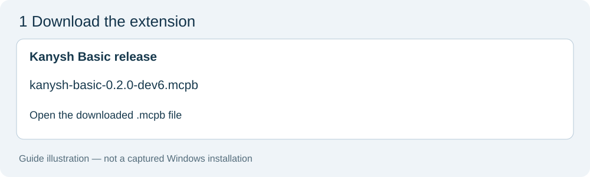
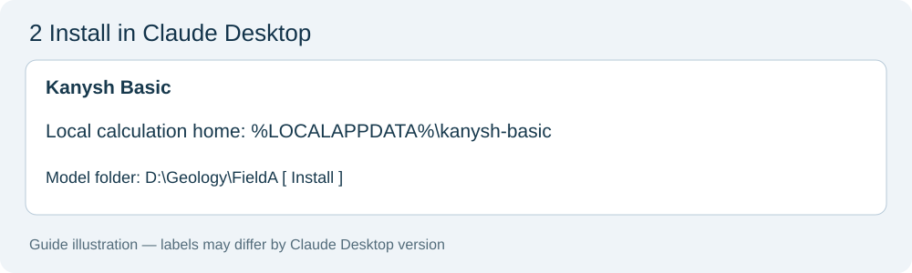
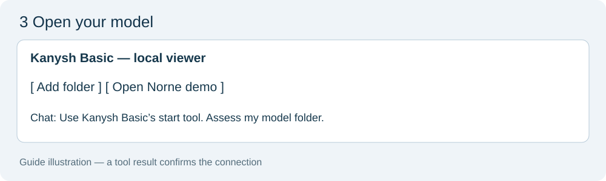

# Install Kanysh Basic on Windows

[Русский](INSTALL_WINDOWS.ru.md) · [Website](https://kanysh.com)

For a **Windows x64 workstation and Claude Desktop** with support for MCPB 0.4's UV
runtime. Static model checks and volume scenarios run natively; **WSL is not needed**.
The extension includes the Norne demo. First installation needs internet access to
fetch Python 3.12 and scientific dependencies; downloads can be substantial.

**Acceptance: native Windows execution, the actual Claude Desktop UV installation and
NVIDIA hardware checks are NOT RUN.** Windows dependency resolution has a separate
check; it is not proof of installation. The pictures below are guide illustrations,
not screenshots of a verified Windows install. Do not promise a validated one-click
release until the acceptance checklist at the end has been completed.

## 1. Download and open the extension

Install/update [Claude Desktop](https://claude.ai/download). From this project's
[releases](https://github.com/almukhanomr/kanysh/releases), download
`kanysh-basic-0.2.0-dev2.mcpb` **if the release provides it**. The GitHub source ZIP
is not the extension. Double-click the `.mcpb` file to open its installation dialog.
If Windows does not associate it with Claude, use Claude's local extension installation
option in its settings. UI names depend on the client version.



## 2. Click Install and select your folders

The results folder defaults to **`%LOCALAPPDATA%\kanysh-basic`**; keep this unless IT
has provided another local results folder. In **Model folder (optional)** choose the
folder exported from Petrel/RMS, for example `D:\Geology\FieldA`. This grants read-only
access to that folder. It does not grant general disk access. You can also select
it later with **Add folder** in the viewer. Input snapshots and results use disk space
in the results folder; original model files are not edited.

Click **Install** and allow Claude's UV runtime to finish downloading dependencies.
Do not close Claude while it installs. The extension cannot display its own progress
before Python is installed: dependency progress/errors belong to Claude's extension
installation UI/log. Once Python starts, `startup.log` and `startup-status.json` appear
in the results folder. `MCP_READY` means the server awaits a client; it does not prove
that Claude has connected. `viewer.log` contains local viewer errors.



The local viewer opens in your browser on first successful startup. Use the URL shown
in the startup log if it does not open. It uses a loopback address on your computer.

## 3. Get your first result

In Claude, write:

> Use Kanysh Basic's start tool. List my registered folders and assess the model folder.
> Tell me what is missing and ask me to confirm units, CRS and datum before importing.

Check that Claude actually calls tools and returns their results. In the viewer,
**Open Norne demo** opens bundled saved results. For your own data, inspect the import
and QC report before calculating. Contacts, Bo/Bg, saturation assumptions and region
selection require your confirmation. [Prepare Petrel/RMS exports](PETREL_EXPORT.md).
[Read results and statuses](GETTING_STARTED.md#5-calculate-a-scenario-and-keep-the-report).



## If installation fails

- **Unsupported extension/runtime:** update Claude Desktop; the host must support MCPB
  0.4 `server.type=uv`. An unsupported host cannot install this package automatically.
  [MCPB UV specification](https://github.com/modelcontextprotocol/mcpb/blob/main/MANIFEST.md#uv-runtime-v04).
- **Download, proxy or certificate error:** give IT the Claude extension installation
  log. Python packages come from PyPI and PyTorch's official CPU index. Python, UV,
  the viewer and package downloads must be allowed by workstation policy.
- **Startup fails:** read `%LOCALAPPDATA%\kanysh-basic\startup.log` and `viewer.log`, or
  the corresponding files in your chosen results folder. Never send confidential models
  or access credentials with a support request.
- **Folder rejected:** choose the real folder on NTFS, not a symbolic link, junction
  or redirected folder. A replaced folder must be registered again. Paths with drive
  letters, spaces, non-English names and case-insensitive lookup have native tests.
  Very long paths also depend on Windows/filesystem policy; a shorter path is a fallback.
- **No release asset yet:** IT can build with `uv run --no-sync python scripts/build_mcpb.py`
  from an installed source checkout. Users should receive the resulting `.mcpb` file.

## GPU NVIDIA (optional, for IT)

The extension installs **CPU PyTorch by default**. Static block imports and copilot
analyses are CPU operations; adding CUDA does not accelerate every calculation. GPU
operation/hardware acceptance remains **NOT RUN**. A compatible NVIDIA driver is
required for the selected CUDA 12.8 build. See [PyTorch installation guidance](https://pytorch.org/get-started/locally/).

Use a separate source environment for GPU work; the CPU extension does not change the
workstation's drivers or silently switch accelerators. In PowerShell, from the source
folder with `uv` installed:

```powershell
uv python install 3.12
uv sync --frozen --no-group cpu --extra gpu --extra ui --extra viewer --python 3.12
uv run --no-sync kanysh-basic --home "$env:LOCALAPPDATA\kanysh-basic-gpu" doctor
```

`cuda_available=true` reports detection, not scientific acceptance. The CPU group and
GPU extra are exclusive. Keep `--no-group cpu --extra gpu` on future sync commands;
plain sync restores the default CPU profile. To register this environment instead of
the extension, disable the extension first and run setup with a separate results home;
review configuration conflicts rather than replacing another registration silently.
Use `uv`, not plain `pip`, for these accelerator index selections.
[uv's PyTorch configuration](https://docs.astral.sh/uv/guides/integration/pytorch/).

## OPM Flow through WSL (optional)

**Only hydrodynamic simulation requires Linux/WSL.** Native Windows simulation tools
return `SOLVER_PLATFORM_UNSUPPORTED` with an explanation; they never report a simulated
result. The `solver` extra installs `resdata` on Linux only. Exporting a simulation deck
is separate from executing OPM Flow. Static model workflows remain native Windows.

For simulation, IT prepares a separate Linux/WSL installation with a chosen OPM Flow
binary, the solver extra and its own calculation home. Do not run two owners against
one SQLite home across Windows and WSL. Follow [supported profiles](SUPPORTED_PROFILES.md). End-to-end OPM acceptance remains **NOT RUN**.

## Windows release acceptance (record actual evidence)

1. On a clean Windows x64 workstation, install this exact MCPB in Claude Desktop;
   record client version, bundle SHA-256 and dependency installation result.
2. Keep the LocalAppData default and choose a real NTFS model folder. Confirm the
   viewer opens, source_list/folder_assess work and Unicode/drive paths are preserved.
3. Open Norne, run a fresh import/QC/scenario, validate the report and export XLSX/PDF.
4. Run Windows CPU pytest, including owner exclusion, cancellation/timeout descendants,
   root replacement, junction rejection and long paths. Record explicit skips.
5. Reconnect/restart Claude, confirm the same home/results, then test NVIDIA separately
   if required. Never change NOT RUN to PASS based solely on a manifest or wheel resolver.
